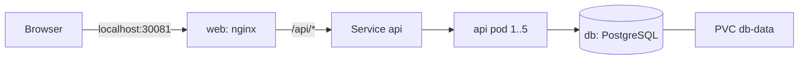

# Greeter - Kubernetes test project for Docker Desktop

A small three-tier app for trying out Kubernetes on Docker Desktop: a web UI, a Python API and a PostgreSQL database, each running in its own pod.

## Architecture



| Component | Image | Description |
|---|---|---|
| `web` | `greeter-web:1.1` | nginx serving the UI and proxying `/api/` to the `api` Service |
| `api` | `greeter-api:1.1` | Flask API: `POST /greet` saves a name and returns a greeting, `GET /names` lists saved names, `GET /health` is the readiness check |
| `db` | `greeter-db:1.0` | PostgreSQL 16 with a `names` table created by `db/init.sql` |

All resources live in the `greeter` namespace.

## Project layout

| Path | Content |
|---|---|
| `api/`, `db/`, `web/` | Source and Dockerfile for each image |
| `manifests/` | One Kubernetes manifest per resource, applied in filename order |
| `loadtest/loadtest.py` | Load generator that drives the API CPU up |
| `build.ps1` | Builds the three Docker images |
| `loadtest.ps1` | Runs the load generator (defaults: 100 workers, 300 s) |

## Run

```powershell
.\build.ps1                    # build the images
kubectl apply -f manifests     # deploy everything
kubectl get pods -n greeter -w # wait until all pods are Running
```

Open http://localhost:30081, enter a name and press "Greet me". The page shows the saved names and which API pod served the request.

Remove everything with `kubectl delete namespace greeter`.

After changing code, run `.\build.ps1` and then `kubectl rollout restart deploy/api deploy/web -n greeter` (or bump the image tag).

## Key behaviours

- **Persistence:** the database data lives in the `db-data` PersistentVolumeClaim, so it survives pod restarts. Deleting the PVC or the namespace deletes the data.
- **Database access:** a NetworkPolicy allows only pods labelled `app: api` to reach the database on port 5432. Enforcement depends on the cluster's network plugin.
- **Load balancing:** the `api` Service spreads connections across all ready API pods. Each response carries an `X-Served-By` header with the pod name.
- **Autoscaling:** a HorizontalPodAutoscaler scales the API between 1 and 5 pods at 60% average CPU (relative to the 50m request). Scale-down waits 30 s. It needs metrics-server, which Docker Desktop does not include.

## Autoscaling setup and load test

Install metrics-server (needed once), allowing the kubelet's self-signed certificate:

```powershell
kubectl apply -f https://github.com/kubernetes-sigs/metrics-server/releases/latest/download/components.yaml
```

Then add `--kubelet-insecure-tls` to the `metrics-server` container args in the `kube-system` namespace.

Generate load and watch the API scale up:

```powershell
.\loadtest.ps1                              # defaults
.\loadtest.ps1 -Workers 50 -Duration 60
kubectl get hpa -n greeter -w               # in a second terminal
```

## Useful commands

```powershell
kubectl get pods,svc,hpa,pvc -n greeter
kubectl logs deploy/api -n greeter
kubectl exec -it -n greeter deploy/db -- psql -U greeter -d greeter -c "SELECT * FROM names;"
kubectl exec -n greeter deploy/db -- pg_dump -U greeter greeter > backup.sql
```

## Notes

- The Secret in `manifests/01-db-secret.yaml` holds a test-only password. Change it for anything beyond local testing.
- Images use the `IfNotPresent` pull policy, so they work with Docker Desktop's built-in Kubernetes. With the kind provisioner, load the images into the cluster first.
