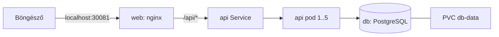

# Greeter - Kubernetes teszt projekt Docker Desktophoz

Egy kis háromrétegű alkalmazás a Kubernetes kipróbálásához Docker Desktopon: webes felület, Python API és PostgreSQL adatbázis, mindegyik a saját podjában fut.

## Architektúra



| Komponens | Image | Leírás |
|---|---|---|
| `web` | `greeter-web:1.1` | nginx: kiszolgálja a felületet, és az `/api/` kéréseket az `api` Service felé továbbítja |
| `api` | `greeter-api:1.1` | Flask API: a `POST /greet` elmenti a nevet és üdvözlést ad vissza, a `GET /names` listázza a mentett neveket, a `GET /health` az állapotellenőrzés (readiness) |
| `db` | `greeter-db:1.0` | PostgreSQL 16, a `names` táblát a `db/init.sql` hozza létre |

Minden erőforrás a `greeter` namespace-ben van.

## Projektszerkezet

| Útvonal | Tartalom |
|---|---|
| `api/`, `db/`, `web/` | Az egyes image-ek forrása és Dockerfile-ja |
| `manifests/` | Erőforrásonként egy Kubernetes manifest, fájlnév szerinti sorrendben alkalmazva |
| `loadtest/loadtest.py` | Terheléskeltő, amely megemeli az API CPU-használatát |
| `build.ps1` | Elkészíti a három Docker image-et |
| `loadtest.ps1` | Elindítja a terheléskeltőt (alapértelmezés: 100 munkaszál, 300 mp) |

## Futtatás

```powershell
.\build.ps1                    # image-ek építése
kubectl apply -f manifests     # minden telepítése
kubectl get pods -n greeter -w # várjuk meg, amíg minden pod Running
```

Nyisd meg a http://localhost:30081 címet, írj be egy nevet, és nyomd meg a "Greet me" gombot. Az oldal megmutatja a mentett neveket és azt, hogy melyik API pod szolgálta ki a kérést.

Az összes erőforrás törlése: `kubectl delete namespace greeter`.

Kódmódosítás után futtasd a `.\build.ps1` parancsot, majd a `kubectl rollout restart deploy/api deploy/web -n greeter` parancsot (vagy emeld meg az image címkéjét).

## Fő működési elvek

- **Adatmegőrzés:** az adatbázis adatai a `db-data` PersistentVolumeClaim-ben vannak, ezért túlélik a pod újraindítását. A PVC vagy a namespace törlésekor az adatok is törlődnek.
- **Adatbázis-hozzáférés:** egy NetworkPolicy csak az `app: api` címkéjű podoknak engedi az adatbázis elérését az 5432-es porton. Az érvényesítés a fürt hálózati bővítményétől függ.
- **Terheléselosztás:** az `api` Service szétosztja a kapcsolatokat az összes kész API pod között. Minden válasz tartalmaz egy `X-Served-By` fejlécet a pod nevével.
- **Automatikus skálázás:** egy HorizontalPodAutoscaler 1 és 5 pod között skálázza az API-t 60%-os átlagos CPU-használatnál (az 50m kéréshez viszonyítva). A visszaskálázás 30 másodpercet vár. Szükséges hozzá a metrics-server, amelyet a Docker Desktop nem tartalmaz.

## Skálázás beállítása és terheléses teszt

Telepítsd a metrics-servert (egyszer kell), és engedélyezd a kubelet önaláírt tanúsítványát:

```powershell
kubectl apply -f https://github.com/kubernetes-sigs/metrics-server/releases/latest/download/components.yaml
```

Ezután add hozzá a `--kubelet-insecure-tls` kapcsolót a `metrics-server` konténer argumentumaihoz a `kube-system` namespace-ben.

Terhelés generálása és az API felskálázódásának figyelése:

```powershell
.\loadtest.ps1                              # alapértelmezett beállítások
.\loadtest.ps1 -Workers 50 -Duration 60
kubectl get hpa -n greeter -w               # egy második terminálban
```

## Hasznos parancsok

```powershell
kubectl get pods,svc,hpa,pvc -n greeter
kubectl logs deploy/api -n greeter
kubectl exec -it -n greeter deploy/db -- psql -U greeter -d greeter -c "SELECT * FROM names;"
kubectl exec -n greeter deploy/db -- pg_dump -U greeter greeter > backup.sql
```

## Megjegyzések

- A `manifests/01-db-secret.yaml` Secret csak teszteléshez használható jelszót tartalmaz. Helyi teszten túli használathoz cseréld le.
- Az image-ek `IfNotPresent` letöltési szabályt használnak, így működnek a Docker Desktop beépített Kubernetesével. A kind szolgáltató esetén előbb be kell tölteni az image-eket a fürtbe.
